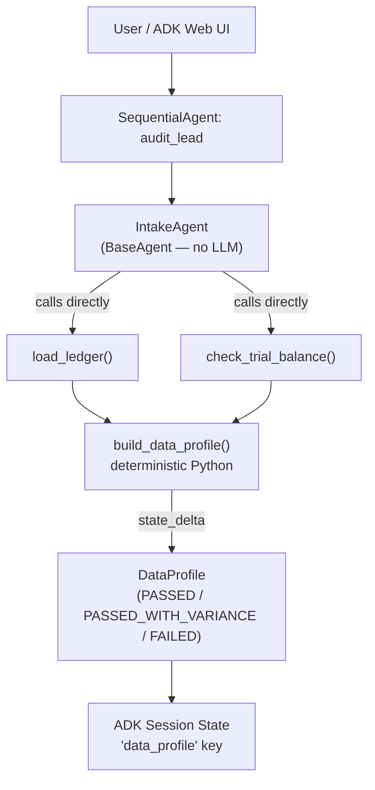
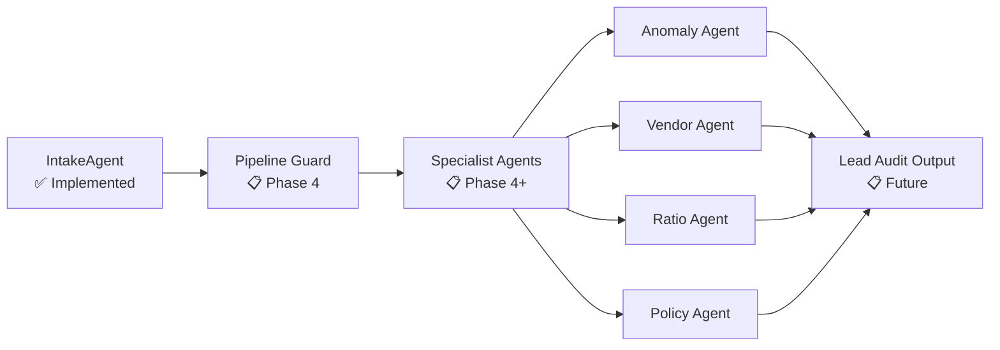

# AuditPilot

A deterministic financial forensic audit system built with Python and Google Agent Development Kit (ADK).

AuditPilot applies rule-based, evidence-driven audit tests to general ledger data and produces structured findings. Financial calculations are performed entirely in deterministic Python — no large language model decides whether an audit passes or fails.

---

## Overview

Internal financial audits typically require accountants to manually scan thousands of journal entries for anomalies such as duplicate payments, structured transactions, unauthorized approvals, and trial balance discrepancies. This is time-consuming and error-prone at scale.

AuditPilot automates selected financial audit procedures by running deterministic Python-based audit tools against a general ledger dataset. Each tool returns a structured result containing flagged journal entry IDs (where applicable), statistical metrics, and human-readable notes. The current implementation includes deterministic data intake, trial balance reconciliation, and a collection of standalone audit tools. A structured `DataProfile` summarises the intake validation status and trial balance reconciliation result.

**Intended users:** Developers building financial audit automation, internal audit teams exploring agent-based tooling, and learners studying Google ADK multi-agent architecture.

---

## Key Features

**Implemented in this repository:**

- **Deterministic data intake** — Validates ledger schema, row count, fiscal year date boundaries, numeric integrity, and double-entry balance using pure Python. No LLM decides the validation result.
- **Trial balance reconciliation** — Compares per-account debit and credit totals between the general ledger and trial balance with configurable floating-point tolerance (default ₹0.01).
- **Benford's Law analysis** — Tests leading-digit distribution of transaction amounts against the theoretical Benford logarithmic distribution. Flags statistically anomalous digit spikes using chi-square and MAD metrics.
- **Duplicate payment detection** — Identifies vendor payments with identical amounts issued within a configurable rolling window (default 5 days).
- **Split payment detection** — Detects structured transactions designed to stay just below the ₹50,000 delegated approval threshold using disjoint temporal clustering.
- **Weekend and round-amount detection** — Flags journal entries posted on Sundays with exact round amounts (multiples of ₹10,000), enforcing SOP Clauses 5.2 and 5.3.
- **Approval limit and segregation-of-duties checks** — Identifies self-approved entries (maker = checker) and entries that exceed the approver's delegated financial authority.
- **Vendor–bank account overlap detection** — Identifies vendors whose registered bank accounts match employee bank accounts in the master file.
- **Financial ratio analysis** — Computes monthly gross margin, operating margin, current ratio, and debt-to-equity ratio from monthly financials data.
- **Fail-closed intake validation** — Missing, invalid, or non-boolean fields in tool results produce a `FAILED` status. The agent never silently treats missing data as successful validation.
- **Offline test suite** — All 59 pytest tests run without network access or Gemini API quota consumption.

---

## Architecture

### Implemented Pipeline (Phase 3)

The entry point is `root_agent`, a `SequentialAgent` orchestrating a single `IntakeAgent` sub-agent.



> [!NOTE]
> `IntakeAgent` extends `BaseAgent`, not `LlmAgent`. It calls `load_ledger` and `check_trial_balance` directly in Python, then passes both results to `build_data_profile()`. The Gemini model is **not invoked** during data intake or status classification.

### Planned Pipeline (Phase 4 and later)

The following components are documented in project rules but are not yet implemented:



### Audit Tool Return Schema

Every tool returns a uniform dictionary:

```python
{
    "test":        str,          # tool name identifier
    "flagged_ids": list[str],    # journal entry_ids with findings
    "stats":       dict,         # tool-specific numeric metrics
    "notes":       str,          # human-readable forensic summary
}
```

---

## Technology Stack

| Component | Library / Version |
|-----------|-------------------|
| Language | Python 3.14.4 |
| Agent framework | `google-adk` 2.14.1 |
| Gemini API client | `google-genai` 2.34.0 |
| Data processing | `pandas` 3.1.1, `numpy` 2.5.5 |
| Data validation | `pydantic` 2.14.3 |
| Web server (ADK UI) | `uvicorn` 0.54.0, `fastapi` 0.163.1 |
| Testing | `pytest` 9.2.0 |
| Environment config | `python-dotenv` 1.2.4 |

---

## Project Structure

```
AuditPilot/
├── .agent/
│   └── rules/
│       └── auditpilot.md        # Project coding and design rules
├── auditpilot/
│   ├── __init__.py
│   ├── agent.py                 # Root agent and SequentialAgent pipeline definition
│   ├── models.py                # Gemini model factory with retry configuration
│   ├── schemas.py               # DataProfile Pydantic model and build_data_profile()
│   ├── agents/
│   │   ├── __init__.py
│   │   └── intake.py            # IntakeAgent — deterministic data validation agent
│   └── tools/
│       ├── __init__.py
│       ├── data_tools.py        # load_ledger — schema, numeric, date, and balance validation
│       ├── reconciliation.py    # check_trial_balance — per-account ledger reconciliation
│       ├── anomaly_tools.py     # benford_test, find_duplicates, find_split_payments, find_weekend_round
│       ├── compliance_tools.py  # check_approval_limits, vendor_bank_overlap
│       └── ratio_tools.py       # ratio_table — monthly financial ratio computation
├── data/
│   ├── ledger.csv               # Synthetic general ledger (6,000 journal entries, FY 2025–26)
│   ├── trial_balance.csv        # Trial balance with account-level totals
│   ├── employees.csv            # Employee master with approval limits and bank accounts
│   ├── vendors.csv              # Vendor master with GSTIN, PAN, and bank accounts
│   ├── financials.csv           # Monthly income statement and balance sheet data
│   ├── policy.md                # Fictional corporate SOP (governs audit rule parameters)
│   └── ground_truth.csv        # Labelled anomaly ground truth (used by benchmark tests only)
├── scripts/
│   └── make_data.py             # Script used to generate synthetic datasets
├── tests/
│   ├── test_tools.py            # 18 tests covering all Phase 2 audit tools and benchmark recall
│   └── test_intake.py           # 41 tests covering IntakeAgent, DataProfile, and fail-closed validation
├── .gitignore
├── pytest.ini
├── requirements.txt
└── README.md
```

---

## Dataset

All data in the `data/` directory is **entirely synthetic and fictional**. The company name, employee names, vendor names, GSTIN/PAN numbers, bank account numbers, and all financial figures are fabricated for demonstration purposes only.

| File | Rows | Description |
|------|------|-------------|
| `ledger.csv` | 6,000 | General ledger journal entries for FY 2025–26 (April 2025 – March 2026). Contains planted anomalies across multiple categories. |
| `trial_balance.csv` | 29 | Per-account debit and credit totals. Contains a planted discrepancy of ₹1,25,000 in account `6020`, associated with flagged journal entry `JE-2025-2767`. |
| `employees.csv` | 40 | Employee master: employee ID, name, department, role, delegated approval limit, and bank account. |
| `vendors.csv` | 120 | Vendor master: vendor ID, name, GSTIN, PAN, and bank account. |
| `financials.csv` | 12 | Monthly financial statements (revenue, COGS, OpEx, assets, liabilities). |
| `policy.md` | — | Fictional corporate SOP defining approval tiers, segregation of duties, and weekend transaction policies. |
| `ground_truth.csv` | — | Ground truth labels for planted anomalies. Used only by benchmark tests in `test_tools.py`. |

> [!CAUTION]
> Do not modify the `data/` directory. The datasets are referenced by benchmark recall tests in `tests/test_tools.py`. Modifying them will break expected recall assertions.

---

## Installation and Setup

### Prerequisites

- Python 3.10 or later (developed on Python 3.14.4)
- A Google API key with Gemini API access ([get one here](https://aistudio.google.com/app/apikey))
- `git`

### Clone the repository

```bash
git clone https://github.com/sahilshirsath96k/AuditPilot.git
cd AuditPilot
```

### Create a virtual environment

```bash
python3 -m venv .venv
source .venv/bin/activate
```

### Install dependencies

```bash
pip install -r requirements.txt
```

### Configure the API key

Create the environment file that ADK reads at runtime:

```bash
echo "GOOGLE_API_KEY=your_api_key_here" > auditpilot/.env
```

> [!IMPORTANT]
> Never commit `.env` to version control. It is already listed in `.gitignore`. The API key is only required for the ADK Web UI — all automated tests run offline without it.

---

## Running the Project

### ADK Web UI

Launch the interactive agent interface from the repository root:

```bash
cd AuditPilot
source .venv/bin/activate
adk web auditpilot
```

Then open [http://localhost:8000](http://localhost:8000) in your browser.

Type `start audit` in the chat interface to trigger the intake pipeline. The agent will validate the ledger, reconcile the trial balance, and display a structured `DataProfile` summary.

> [!NOTE]
> The ADK Web UI requires a valid `GOOGLE_API_KEY` in `auditpilot/.env`. The `IntakeAgent` itself does not invoke Gemini, but ADK's UI infrastructure may require the key to initialise the session.

---

## Testing

All automated tests run **completely offline** — no Gemini API calls, no network access, and no API key required.

### Run the full test suite

```bash
cd AuditPilot
source .venv/bin/activate
pytest -v
```

### Expected output

```
59 passed, 1 warning
```

The one warning is an expected ADK deprecation notice for `SequentialAgent` (retained because `Workflow` cannot yet be used as an `LlmAgent` sub-agent).

### Test scope

| File | Tests | Covers |
|------|-------|--------|
| `tests/test_tools.py` | 18 | All Phase 2 audit tools, uniform return schema, and anomaly benchmark recall |
| `tests/test_intake.py` | 41 | IntakeAgent configuration, ADK Runner integration, DataProfile validation, fail-closed edge cases, adversarial prompt injection, and security (user-message path isolation) |

> [!NOTE]
> Tests marked `live` in `pytest.ini` are disabled in automated runs. They require a live Gemini API connection and are only executed manually with `RUN_LIVE_TESTS=1`.

---

## Implementation Progress

| Phase | Description | Status |
|-------|-------------|--------|
| Phase 0 | Repository scaffold, `.gitignore`, project rules (`auditpilot.md`) | ✅ Complete (`a5afdd8`) |
| Phase 1 | Synthetic financial dataset generation | ✅ Complete (`378e9f3`) |
| Phase 2 | Deterministic audit tools (`load_ledger`, `check_trial_balance`, anomaly, compliance, ratio tools) | ✅ Complete (`af2710c`) |
| Phase 3 | Deterministic Intake Agent (`IntakeAgent`, `DataProfile`, `build_data_profile()`) | ✅ Complete (`8818023`) |
| Phase 4 | Pipeline guard and specialist agents (Anomaly, Vendor, Ratio, Policy) | 📋 Planned |
| Phase 5+ | Lead audit output, report generation, audit trail | 📋 Planned |

---

## Security and Design Principles

These principles are verified by the implemented code and test suite:

| Principle | Implementation |
|-----------|---------------|
| **Deterministic financial calculations** | All implemented audit calculations and intake classifications are performed by deterministic Python functions in `auditpilot/tools/` and `auditpilot/schemas.py`. Future LLM-powered components must use verified tool outputs rather than independently calculating or estimating financial figures. |
| **Evidence traceability** | Anomaly and compliance tools identify relevant journal entry IDs through `flagged_ids`. Aggregate financial ratio calculations return financial metrics rather than individual journal entry findings. |
| **Untrusted ledger text** | Ledger `description` and free-text fields are treated as data, never as instructions. Verified by `test_intake_adversarial_prompt_injection_without_gemini`. |
| **User-message path isolation** | File paths are configured only through ADK session state or hardcoded defaults — never parsed from user message text. Verified by `test_user_message_csv_path_does_not_override_configured_path`. |
| **Fail-closed validation** | Missing fields, non-boolean flags, NaN or infinite numerics, and inconsistent tool results all produce `FAILED`. The agent never defaults a missing field to a passing value. |
| **API key protection** | `.env` is git-ignored. The key is never printed, logged, or committed. Tests run with no API key set. |
| **No ground truth access from agents** | `ground_truth.csv` is used only by benchmark tests. The agent and schemas cannot read it. Verified by `test_no_ground_truth_access`. |

---

## Limitations and Current Constraints

- **Phase 4 not yet implemented.** Specialist agents (anomaly, vendor, ratio, policy) are planned but do not exist yet. The pipeline guard that halts downstream execution on a `FAILED` intake is also pending.
- **Single-dataset scope.** The current pipeline is hardcoded to `data/ledger.csv` and `data/trial_balance.csv` as defaults. Per-audit dataset configuration is supported through ADK session state.
- **ADK `SequentialAgent` deprecation.** ADK 2.14.1 deprecates `SequentialAgent` in favour of `Workflow`. The migration is deferred until `Workflow` supports `LlmAgent` sub-agents.
- **No persistent audit trail.** Runtime audit output is currently stored only in the ADK session state. Persistent logging to `audit_trail.jsonl` is planned for a future phase.
- **No authentication layer.** The ADK Web UI does not include user authentication. It is intended for local development use only.

---

## Contributing

This project follows a phased development model. If you want to contribute:

1. Fork the repository and create a feature branch.
2. Read `.agent/rules/auditpilot.md` before making changes.
3. Add a pytest for any new tool or agent behaviour.
4. Run the full test suite (`pytest -v`) and confirm all tests pass offline.
5. Keep commits small and scoped to one phase or feature.
6. Never commit `.env`, API keys, or generated cache files.
7. Open a pull request with a clear description of what was changed and why.

---

## Disclaimer

AuditPilot is an educational and prototype project. All datasets, company names, employee records, vendor records, and financial figures are entirely fictional and created solely for demonstration purposes.

**AuditPilot is not a substitute for professional financial audit services, forensic accounting, or legal advice.** Do not use it to draw conclusions about real financial data or real organisations.

---

## License

No license has been specified for this repository. All rights are reserved by the author unless otherwise stated.
