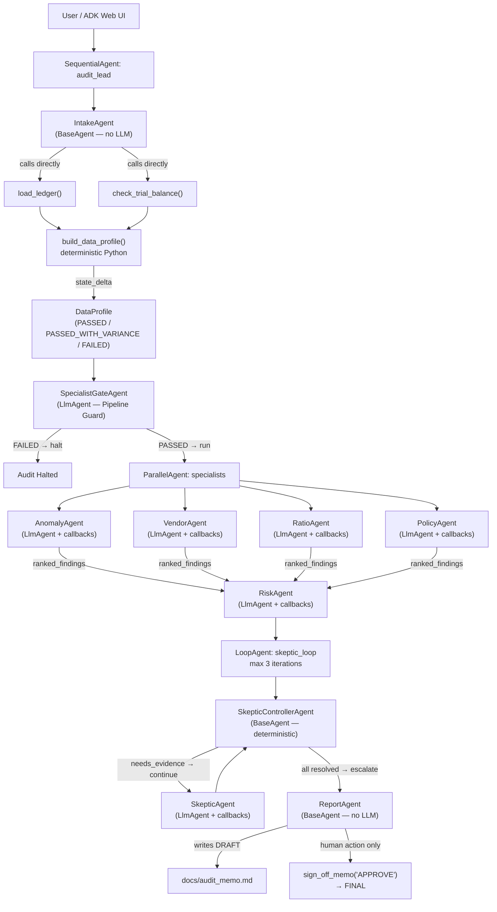
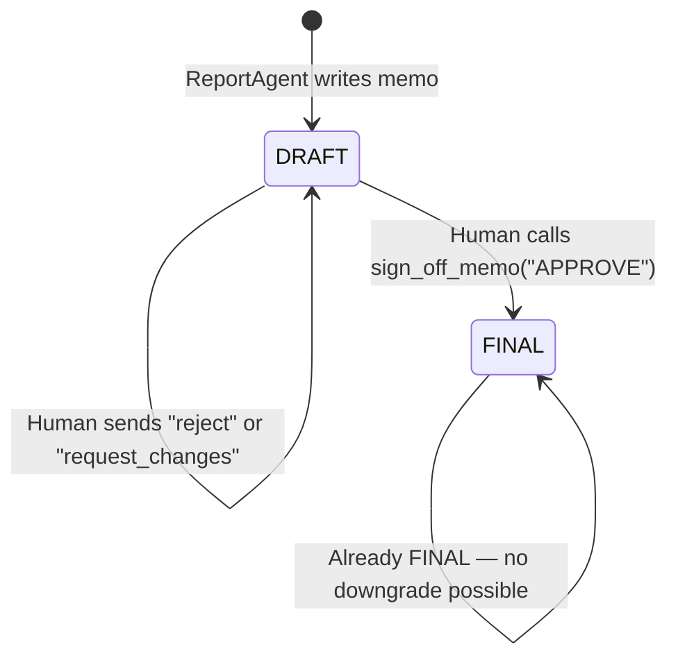

# AuditPilot

A deterministic financial forensic audit system built with Python and Google Agent Development Kit (ADK).

AuditPilot applies rule-based, evidence-driven audit tests to general ledger data and produces structured findings. Financial calculations are performed entirely in deterministic Python — no large language model decides whether an audit passes or fails.

---

## Overview

Internal financial audits typically require accountants to manually scan thousands of journal entries for anomalies such as duplicate payments, structured transactions, unauthorized approvals, and trial balance discrepancies. This is time-consuming and error-prone at scale.

AuditPilot automates selected financial audit procedures by running deterministic Python-based audit tools against a general ledger dataset. Each tool returns a structured result containing flagged journal entry IDs, statistical metrics, and human-readable notes. The full pipeline covers data intake, parallel specialist analysis, risk ranking, adversarial skeptic review, human-approved report generation, and a tamper-evident audit trail with security callbacks.

**Intended users:** Developers building financial audit automation, internal audit teams exploring agent-based tooling, and learners studying Google ADK multi-agent architecture.

---

## Key Features

- **Deterministic data intake** — Validates ledger schema, row count, fiscal year date boundaries, numeric integrity, and double-entry balance using pure Python. No LLM decides the validation result.
- **Trial balance reconciliation** — Compares per-account debit and credit totals between the general ledger and trial balance with configurable floating-point tolerance (default ₹0.01).
- **Benford's Law analysis** — Tests leading-digit distribution of transaction amounts against the theoretical Benford logarithmic distribution. Flags statistically anomalous digit spikes using chi-square and MAD metrics.
- **Duplicate payment detection** — Identifies vendor payments with identical amounts issued within a configurable rolling window (default 5 days).
- **Split payment detection** — Detects structured transactions designed to stay just below the ₹50,000 delegated approval threshold using disjoint temporal clustering.
- **Weekend and round-amount detection** — Flags journal entries posted on Sundays with exact round amounts (multiples of ₹10,000), enforcing SOP Clauses 5.2 and 5.3.
- **Approval limit and segregation-of-duties checks** — Identifies self-approved entries (maker = checker) and entries that exceed the approver's delegated financial authority.
- **Vendor–bank account overlap detection** — Identifies vendors whose registered bank accounts match employee bank accounts in the master file.
- **Financial ratio analysis** — Computes monthly gross margin, operating margin, current ratio, and debt-to-equity ratio from monthly financials data.
- **Risk ranking** — Scores each finding deterministically by likelihood × impact and ranks them. No LLM scores risks.
- **Skeptic review loop** — A `LoopAgent` (max 3 iterations) cross-examines findings for corroborating evidence. Unresolved findings are escalated; unsupported findings are dropped with reasons.
- **Human-approved audit memo** — Report is generated as `DRAFT`. It becomes `FINAL` only on explicit human `sign_off_memo("APPROVE")`. The report agent can never approve its own output.
- **ADK callbacks and audit trail** — `before_model_callback` masks bank account numbers and blocks prompt-injection payloads before the LLM sees them. `after_tool_callback` logs every tool execution to `audit_trail.jsonl` with canonical SHA-256 provenance hashes.
- **Fail-closed intake validation** — Missing, invalid, or non-boolean fields in tool results produce a `FAILED` status. The agent never silently treats missing data as successful validation.
- **Offline test suite** — All 137 pytest tests run without network access or Gemini API quota consumption.
- **Quantitative evaluation** — `evals/run_eval.py` runs 3 deterministic passes against the seeded ground-truth benchmark: **100% recall, 100% precision, F1 = 1.0, σ = 0.0000**.

---

## Architecture

### Full Implemented Pipeline



> [!NOTE]
> `IntakeAgent` and `ReportAgent` extend `BaseAgent` — they never invoke the Gemini model. The Gemini model is only used in the six specialist/risk/skeptic `LlmAgent` instances to interpret tool results and decide which tools to call. Financial calculations and classifications are always done by deterministic Python tools.

### Callback Security Layer

Every `LlmAgent` has two callbacks registered:

| Callback | Trigger | Action |
|----------|---------|--------|
| `before_model_guardrail` | Before every Gemini call | Masks 11–18 digit bank account numbers; blocks prompt-injection payloads |
| `after_tool_audit_logger` | After every tool call | Logs tool name, sanitized args, and SHA-256 of result to `audit_trail.jsonl` |

### Audit Tool Return Schema

Every tool returns a uniform dictionary:

```python
{
    "test":        str,          # tool name identifier
    "flagged_ids": list[str],    # journal entry_ids with findings
    "passed":      bool,         # True = no anomalies found
    "note":        str,          # human-readable summary
    # tool-specific additional fields (metrics, counts, amounts)
}
```

### Session State Keys

| Key | Written by | Read by |
|-----|-----------|---------|
| `data_profile` | `IntakeAgent` | `SpecialistGateAgent` |
| `anomaly_result` | `AnomalyAgent` | `RiskAgent` |
| `vendor_result` | `VendorAgent` | `RiskAgent` |
| `ratio_result` | `RatioAgent` | `RiskAgent` |
| `policy_result` | `PolicyAgent` | `RiskAgent` |
| `ranked_findings` | `RiskAgent` | `SkepticControllerAgent` |
| `skeptic_reviews` | `SkepticAgent` | `SkepticControllerAgent` |
| `report_status` | `ReportAgent` | Router sign-off gate |
| `sign_off_record` | `sign_off_memo()` | Audit trail |

---

## Project Structure

```
AuditPilot/
├── auditpilot/
│   ├── agents/
│   │   ├── intake.py              # IntakeAgent (BaseAgent, no LLM)
│   │   ├── anomaly.py             # AnomalyAgent (LlmAgent)
│   │   ├── vendor.py              # VendorAgent (LlmAgent)
│   │   ├── ratio.py               # RatioAgent (LlmAgent)
│   │   ├── policy.py              # PolicyAgent (LlmAgent)
│   │   ├── risk.py                # RiskAgent (LlmAgent)
│   │   ├── skeptic.py             # SkepticAgent (LlmAgent) + skeptic_loop (LoopAgent)
│   │   ├── skeptic_controller.py  # SkepticControllerAgent (BaseAgent, deterministic)
│   │   ├── report.py              # ReportAgent (BaseAgent, no LLM)
│   │   └── pipeline.py            # SpecialistGateAgent, audit_lead (root_agent)
│   ├── tools/
│   │   ├── intake_tools.py        # load_ledger, check_trial_balance, build_data_profile
│   │   ├── anomaly_tools.py       # detect_duplicates, detect_splits, detect_sunday_round
│   │   ├── compliance_tools.py    # check_approval_limits, check_self_approval
│   │   ├── vendor_tools.py        # detect_ghost_vendors, detect_shared_bank_accounts
│   │   ├── ratio_tools.py         # compute_financial_ratios
│   │   ├── risk_tools.py          # build_ranked_findings (likelihood × impact scoring)
│   │   ├── skeptic_tools.py       # verify_entry_ids
│   │   └── report_tools.py        # format_audit_memo, write_audit_memo, sign_off_memo
│   ├── callbacks.py               # before_model_guardrail, after_tool_audit_logger, masking
│   ├── schemas.py                 # DataProfile, Finding, RankedFindings, SkepticReview*
│   └── router.py                  # ADK router + human sign-off gate
├── evals/
│   ├── run_eval.py                # Offline evaluation runner (ground-truth isolated)
│   └── results.md                 # Benchmark report (auto-generated)
├── docs/
│   └── audit_memo.md              # Generated audit memo (DRAFT → FINAL on approval)
├── data/
│   ├── ledger.csv                 # 6,000 synthetic journal entries (FY 2025-26)
│   ├── trial_balance.csv          # Trial balance (intentional ₹125,000 gap on Account 6020)
│   ├── vendors.csv                # Vendor master with bank account numbers
│   ├── employees.csv              # Employee master with bank account numbers
│   ├── monthly_financials.csv     # Monthly P&L and balance sheet data
│   └── ground_truth.csv           # Anomaly labels (eval only — agents cannot read this)
├── tests/
│   ├── test_intake.py             # IntakeAgent, DataProfile, fail-closed edge cases
│   ├── test_tools.py              # Audit tools, risk tools, skeptic tools
│   ├── test_schemas.py            # Finding, RankedFindings, SkepticReview Pydantic models
│   ├── test_report.py             # ReportAgent, format_audit_memo, sign_off_memo gate
│   └── test_guardrails.py         # Callbacks, bank account masking, audit trail, security
├── .agent/rules/auditpilot.md     # Project rules and development constraints
└── pytest.ini
```

---

## Getting Started

### Prerequisites

- Python 3.12 or later
- `pip` (or any compatible package manager)

### Installation

```bash
git clone https://github.com/sahilshirsath96k/AuditPilot.git
cd AuditPilot

python -m venv .venv
source .venv/bin/activate        # Windows: .venv\Scripts\activate

pip install -r requirements.txt
```

### Configuration

Create a `.env` file in the project root (this file is git-ignored):

```env
GOOGLE_API_KEY=your_gemini_api_key_here
```

> [!IMPORTANT]
> The API key is only needed to run the system interactively with the ADK Web UI. All pytest tests are fully offline and do not require an API key.

### Running the Test Suite

```bash
source .venv/bin/activate
pytest -v
# Expected: 137 passed, 3 warnings
```

All tests run offline. The 3 warnings are expected ADK deprecation notices for `LoopAgent`, `ParallelAgent`, and `SequentialAgent` (see [Limitations](#limitations-and-current-constraints)).

### Running the Evaluation Benchmark

```bash
source .venv/bin/activate
python evals/run_eval.py --runs 3 --output evals/results.md
```

This runs 3 deterministic passes against the seeded ground-truth benchmark without any Gemini API calls and writes results to `evals/results.md`.

### Launching the Interactive Audit (ADK Web UI)

```bash
source .venv/bin/activate
adk web
```

Open the URL shown in the terminal. Select `audit_lead` as the agent. Send any message (e.g., `start audit`) to begin the pipeline.

To approve the generated audit memo after the pipeline completes:

```
approve
```

To request changes:

```
reject
request_changes
```

---

## Evaluation Results

The benchmark measures recall, precision, and F1 against 57 seeded anomalies in `data/ledger.csv` across 7 categories:

| Anomaly Category | Ground Truth | Flagged | Recall | Precision | F1 |
|:---|:---:|:---:|:---:|:---:|:---:|
| `duplicate_payment` | 10 | 10 | **100.0%** | **100.0%** | 1.0000 |
| `sunday_round_amount` | 12 | 12 | **100.0%** | **100.0%** | 1.0000 |
| `split_payment` | 18 | 18 | **100.0%** | **100.0%** | 1.0000 |
| `self_approved` | 8 | 8 | **100.0%** | **100.0%** | 1.0000 |
| `ghost_vendor` | 5 | 5 | **100.0%** | **100.0%** | 1.0000 |
| `shared_bank_account` | 3 | 3 | **100.0%** | **100.0%** | 1.0000 |
| `trial_balance_gap` | 1 | 1 | **100.0%** | **100.0%** | 1.0000 |
| **Micro-Average** | **57** | **57** | **100.0%** | **100.0%** | **1.0000** |

**Cross-run stability:** σ = 0.0000 (fully deterministic across all 3 runs).

> [!NOTE]
> These results reflect deterministic tool performance on a seeded synthetic dataset. All 57 anomalies were planted and labelled during dataset generation. Real-world accounting data will have unlabelled anomalies, overlapping patterns, and noise not present here.

Full report: [`evals/results.md`](evals/results.md)

---

## Human Sign-Off Gate

The audit memo goes through a strict two-state lifecycle:



- `ReportAgent` generates the memo as `DRAFT` and **cannot approve its own output**.
- `sign_off_memo` is **not exposed** as an agent tool — it can only be invoked by an explicit human action through the router.
- Every approval decision records reviewer name, decision, timestamp, comments, previous status, and resulting status in the session state.
- A `FINAL` report cannot be downgraded or silently overwritten.

---

## Tests

| File | Tests | Coverage |
|------|------:|---------|
| `tests/test_intake.py` | 41 | IntakeAgent, DataProfile validation, fail-closed edge cases, path isolation, adversarial prompt injection |
| `tests/test_tools.py` | 42 | All audit tools (anomaly, vendor, ratio, compliance), risk tools, skeptic tools |
| `tests/test_schemas.py` | 5 | Finding, RankedFindings, SkepticReview, SkepticReviewBatch Pydantic validation |
| `tests/test_report.py` | 17 | ReportAgent memo generation, sign-off gate states, FINAL protection, dropped-findings appendix |
| `tests/test_guardrails.py` | 32 | Bank account masking, before-model callbacks, audit trail logging, SHA-256 hashing, ground-truth isolation, prompt-injection detection |
| **Total** | **137** | **100% offline — no API key required** |

> [!NOTE]
> Tests marked `live` in `pytest.ini` are disabled in automated runs. They require a live Gemini API connection and are only executed manually with `RUN_LIVE_TESTS=1`.

---

## Implementation Progress

| Phase | Description | Status |
|-------|-------------|--------|
| Phase 0 | Repository scaffold, `.gitignore`, project rules (`auditpilot.md`) | ✅ Complete (`a5afdd8`) |
| Phase 1 | Synthetic financial dataset generation (6,000 entries, 57 planted anomalies) | ✅ Complete (`378e9f3`) |
| Phase 2 | Deterministic audit tools (`load_ledger`, `check_trial_balance`, anomaly, compliance, ratio tools) | ✅ Complete (`af2710c`) |
| Phase 3 | Deterministic Intake Agent (`IntakeAgent`, `DataProfile`, `build_data_profile()`) | ✅ Complete (`8818023`) |
| Phase 4 | Pipeline guard and specialist agents (Anomaly, Vendor, Ratio, Policy) with `ParallelAgent` | ✅ Complete |
| Phase 5 | Lead orchestration, session-state contracts, and agent routing | ✅ Complete |
| Phase 6 | Risk Ranking Agent — deterministic likelihood × impact scoring, `Finding` / `RankedFindings` schemas | ✅ Complete |
| Phase 7 | Skeptic Review Loop — `LoopAgent` (max 3 iterations), evidence verification, dropped-findings retention | ✅ Complete |
| Phase 8 | Report Agent and human sign-off gate — `DRAFT` → `FINAL` lifecycle, auditable sign-off record | ✅ Complete |
| Phase 9 | ADK callbacks, tamper-evident audit trail (SHA-256), bank account masking, ground-truth isolation, evaluation benchmark | ✅ Complete |

---

## Security and Design Principles

| Principle | Implementation |
|-----------|---------------|
| **Deterministic financial calculations** | All audit calculations, intake classifications, and risk scores are performed by deterministic Python functions. LLM agents interpret tool results and decide which tools to call — they never calculate or estimate financial figures independently. |
| **Bank account masking** | `before_model_guardrail` replaces all 11–18 digit bank account numbers with `[REDACTED_ACCOUNT_****XXXX]` before the LLM receives any text. Deterministic tools always use real data from CSV files. |
| **Prompt-injection resistance** | Ledger `description` fields are treated as untrusted data, never instructions. The callback layer detects and blocks injection payloads. Verified by `test_guardrails.py`. |
| **User-message path isolation** | File paths are configured only through ADK session state or hardcoded defaults — never parsed from user message text. Verified by `test_user_message_csv_path_does_not_override_configured_path`. |
| **Tamper-evident audit trail** | Every tool call is logged to `audit_trail.jsonl` with a canonical SHA-256 hash of the result (sorted keys, no whitespace). Log entries never contain raw account numbers, API keys, or secrets. |
| **Fail-closed validation** | Missing fields, non-boolean flags, NaN or infinite numerics, and inconsistent tool results all produce `FAILED`. The agent never defaults a missing field to a passing value. |
| **Ground-truth isolation** | `data/ground_truth.csv` is accessible only to `evals/run_eval.py`. Production agents, tools, and schemas have no read path to it. Verified by `test_ground_truth_isolation_from_production_code`. |
| **API key protection** | `.env` is git-ignored. The key is never printed, logged, or committed. All tests run with no API key set. |
| **Human-only report approval** | `sign_off_memo` is intentionally not registered as an agent tool. The LLM cannot approve, finalize, or downgrade any audit report. Only an explicit human action through the router can invoke it. |

---

## Limitations and Current Constraints

- **100% recall on synthetic data only.** The benchmark operates on a seeded dataset with known, labelled anomalies. Real-world ledgers contain unlabelled noise, overlapping patterns, and anomaly types not covered by the current tool set.
- **ADK deprecation warnings.** ADK 2.14.1 deprecates `LoopAgent`, `ParallelAgent`, and `SequentialAgent` in favour of `Workflow`. The migration is deferred because ADK 2.14.1 does not yet support `LlmAgent` sub-agents inside `Workflow`.
- **SHA-256 hashes provide provenance, not immutability.** The `audit_trail.jsonl` file itself can be overwritten by a system administrator. The hashes establish tamper-evidence; they do not make the log file cryptographically immutable.
- **No authentication layer.** The ADK Web UI does not include user authentication. It is intended for local development use only.
- **Single-dataset scope.** The pipeline defaults to `data/ledger.csv` and `data/trial_balance.csv`. Per-audit dataset configuration is supported through ADK session state.

---

## Contributing

This project follows a phased development model. If you want to contribute:

1. Fork the repository and create a feature branch.
2. Read `.agent/rules/auditpilot.md` before making changes.
3. Add a pytest for any new tool or agent behaviour.
4. Run the full test suite (`pytest -v`) and confirm all tests pass offline.
5. Keep commits small and scoped to one phase or feature.
6. Never commit `.env`, API keys, or generated cache files.
7. Open a pull request with a clear description of what was changed and why.

---

## Disclaimer

AuditPilot is an educational and prototype project. All datasets, company names, employee records, vendor records, and financial figures are entirely fictional and created solely for demonstration purposes.

**AuditPilot is not a substitute for professional financial audit services, forensic accounting, or legal advice.** Do not use it to draw conclusions about real financial data or real organisations.

---

## License

No license has been specified for this repository. All rights are reserved by the author unless otherwise stated.
